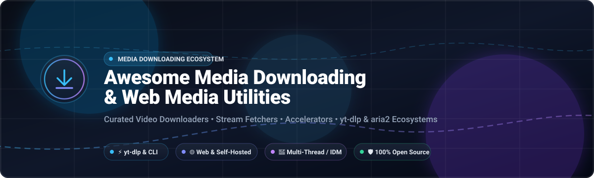

<p align="center">
  
</p>

# 🎬 Awesome Media Downloading & Web Media Utilities 🚀

<p align="center">
  <a href="https://github.com/ishandutta2007/Awesome-Awesome-Awesome"></a><a href="https://discord.gg/jc4xtF58Ve"></a>
  <a href="https://github.com/ishandutta2007/Awesome-Awesome-Awesome"></a>
  <a href="#-open-source-github-projects"></a>
  <a href="LICENSE"></a>
  <a href="#-how-to-contribute"></a>
  <a href="https://github.com/ishandutta2007"></a>
</p>

> 🌟 A curated collection of premier **Media Downloading Software**, **Web Video Downloaders**, **Self-Hosted Download Accelerators**, and **Streaming Media Fetching Utilities**. Covering industry-leading SaaS desktop suites, browser extension tools, and active open-source GitHub projects.

---

## 📑 Table of Contents
- [📊 Sector Overview & Market Dynamics](#-sector-overview--market-dynamics)
- [💼 SaaS & Commercial Platforms](#-saas--commercial-platforms)
- [🐙 Open-Source GitHub Projects](#-open-source-github-projects)
- [🏗️ Architectural Frameworks & Stacks](#️-architectural-frameworks--stacks)
- [💖 Support](#-support)
- [⭐ Star History](#-star-history)
- [🤝 How to Contribute](#-how-to-contribute)
- [⚖️ Disclaimer](#️-disclaimer)

---

## 📊 Sector Overview & Market Dynamics

The global media downloading and video download management software market is estimated at **$2.0B – $2.4B**, driven by surging consumer demand for offline media consumption, content archiving, format interoperability, and creator workflows across an online video streaming sector exceeding $800B. 

The industry demonstrates **moderate-to-high fragmentation** characterized by a dual-track ecosystem: commercial utility vendors (e.g., EaseUS, Tonec/IDM, Open Media) compete on turnkey desktop conveniences, OS integration, and browser hooking, while a dominant, collaborative open-source core (anchored by `yt-dlp` and `aria2`) serves as the de facto engine powering dozens of community GUIs, self-hosted web frontends, and mobile downloaders.

---

## 💼 SaaS & Commercial Platforms

Commercial desktop clients and hosted download services ranked by company scale (estimated annual revenue and valuation):

| Product | Company / Developer | Scale & Valuation (Est.) | Starting Price (Paid Tier) | Free Tier Limits / Free Trial | Key Features |
| :--- | :--- | :--- | :--- | :--- | :--- |
| **[EaseUS Video Downloader](https://www.easeus.com/)** | 🏢 EaseUS Software (Chengdu Chuangyi Hi-Tech) | **$15M – $25M** ARR (Valuation: ~$50M – $80M) | $12.99 / month (or $39.99 lifetime) | Free trial capped at **2 to 5 video downloads total** | 8K/4K batch video downloads, audio ripping, 1,000+ streaming sites supported. |
| **[Internet Download Manager (IDM)](https://internet-download-manager.com/)** | 🏢 Tonec Inc. | **$10M – $15M** ARR (Valuation: ~$30M – $45M) | $11.95 / year (or $24.95 lifetime 1-PC) | **30-day free trial** (fully functional, stops operating after 30 days) | Proprietary dynamic file segmentation, multi-threaded acceleration up to 8x, browser integration. |
| **[Any Video Converter](https://www.any-video-converter.jp/)** | 🏢 Anvsoft Inc. | **$5M – $10M** ARR (Valuation: ~$15M – $25M) | $9.95 / month (or $39.95 lifetime) | **Free forever plan** (unlimited standard video/audio conversion; AI enhancement & 10x turbo downloads locked) | Universal video/audio format transcode, basic downloader, built-in player, DVD authoring. |
| **[4K Video Downloader](https://www.4kdownload.com/products/product-videodownloader)** | 🏢 Open Media LLC (Open Media OOO) | **$3M – $8M** ARR (Valuation: ~$10M – $20M) | $15.00 / year Lite (or $25.00 lifetime Personal) | **Free forever Starter plan** capped at **10 single video downloads/day** & **10 videos per playlist/channel** | High-fidelity 4K/8K stream extraction, multi-lingual YouTube subtitle downloading, private media fetching. |
| **[Airy](https://www.airy-youtube-downloader.com/mac/)** | 🏢 Electronic Team, Inc. (Eltima Software) | **$2M – $5M** ARR (Valuation: ~$5M – $12M) | $19.95 lifetime Personal (1 Mac/PC) | Free trial capped at **2 video downloads total** (first 2 items per playlist) | Clean native macOS/Windows client, MP3 sound extraction, browser bookmarklet integration. |
| **[ByClick Downloader](https://www.byclickdownloader.com/)** | 🏢 ByClick Ltd. | **$1M – $3M** ARR (Valuation: ~$3M – $8M) | $11.99 / year (or $14.99 lifetime 1-PC) | **Free trial edition** (restricted quality caps, limited daily downloads, bulk/playlist features locked) | One-click auto-detection popup for web browsers, full YouTube playlist and Instagram backup. |
| **[YTD Video Downloader](https://www.ytddownloader.com/)** | 🏢 GreenTree Applications SRL | **$1M – $3M** ARR (Valuation: ~$3M – $7M) | $2.99 / month (annual billing) | **Free forever plan** capped at **1080p resolution maximum**, single concurrent download queue, slower standard speeds | Converts to MP4/WMV/AVI/MP3, supports 50+ video portals, basic integrated media player. |
| **[Video DownloadHelper](https://www.downloadhelper.net/)** | 👨‍💻 mig / ACLAP | **$500K – $1.5M** ARR (Valuation: ~$1.5M – $3.5M) | $19.00 / year (or $39.00 lifetime) | **Free forever tier** (unlimited direct streams, but complex HLS/DASH downloads limited to **3 starts then 1 download per 2-hour cooldown**) | Ubiquitous browser extension (Firefox, Chrome, Edge), deep protocol media sniffing, companion app conversion. |
| **[ClipGrab](https://clipgrab.de/)** | 👨‍💻 Philipp Schmieder (Indie) | Bootstrapped Indie (< $250K ARR) | Free / Donation-supported ($0) | **100% Free forever** (donation-supported, no paid paywall tiers) | Multi-platform Qt GUI client, automatic clipboard link recognition, integrated YouTube search. |

---

## 🐙 Open-Source GitHub Projects

Curated top-tier open-source tools, download engines, headless daemons, and graphical user interfaces. Sorted descending by GitHub stargazers count:

1. **[yt-dlp/yt-dlp](https://github.com/yt-dlp/yt-dlp)** [](https://github.com/yt-dlp/yt-dlp/stargazers)  
   ⚡ The gold standard command-line media downloader and actively maintained fork of youtube-dl with thousands of site extractors, performance patches, sponsorblock integration, and format options.

2. **[ytdl-org/youtube-dl](https://github.com/ytdl-org/youtube-dl)** [](https://github.com/ytdl-org/youtube-dl/stargazers)  
   📹 The foundational Python command-line utility for downloading video and audio from YouTube and hundreds of other web portals that established the media extraction ecosystem.

3. **[agalwood/Motrix](https://github.com/agalwood/Motrix)** [](https://github.com/agalwood/Motrix/stargazers)  
   🚀 Full-featured, elegant desktop download manager built on Electron and aria2 with support for HTTP, FTP, BitTorrent, and Magnet links across Windows, macOS, and Linux.

4. **[soimort/you-get](https://github.com/soimort/you-get)** [](https://github.com/soimort/you-get/stargazers)  
   📥 Tiny, flexible command-line web media scraper written in Python with specialized support for international and regional streaming media hubs.

5. **[team-spotube/spotube](https://github.com/team-spotube/spotube)** [](https://github.com/team-spotube/spotube/stargazers)  
   🎧 Open-source, cross-platform music streaming and downloading client built with Flutter, leveraging Spotify data endpoints alongside YouTube/Piped media streams with zero telemetry.

6. **[imputnet/cobalt](https://github.com/imputnet/cobalt)** [](https://github.com/imputnet/cobalt/stargazers)  
   🌐 Privacy-respecting, modern web media downloader with an AGPL-3.0 backend and reactive web UI; features no advertisements, tracking scripts, or payloads.

7. **[aria2/aria2](https://github.com/aria2/aria2)** [](https://github.com/aria2/aria2/stargazers)  
   ⚡ High-speed, multi-protocol, multi-source command-line download accelerator operating over HTTP/HTTPS, FTP, SFTP, BitTorrent, and Metalink with JSON-RPC remote control.

8. **[TeamNewPipe/NewPipe](https://github.com/TeamNewPipe/NewPipe)** [](https://github.com/TeamNewPipe/NewPipe/stargazers)  
   📱 Lightweight Android streaming and offline caching frontend that parses website content directly without proprietary Google Play Services or YouTube API tokens.

9. **[iawia002/lux](https://github.com/iawia002/lux)** [](https://github.com/iawia002/lux/stargazers)  
   🏎️ Blazing-fast command-line video download utility and Go library (formerly Annie) with multi-threaded chunk downloading and broad site coverage.

10. **[JunkFood02/Seal](https://github.com/JunkFood02/Seal)** [](https://github.com/JunkFood02/Seal/stargazers)  
    🦭 Modern Android video/audio downloader interface styled in Material You, built directly on top of yt-dlp with custom format profiles and subtitle fetching.

11. **[GopeedLab/gopeed](https://github.com/GopeedLab/gopeed)** [](https://github.com/GopeedLab/gopeed/stargazers)  
    🔥 High-performance, modern cross-platform download manager developed in Go and Flutter supporting HTTP, BitTorrent, Magnet, HLS (m3u8), and extension scripts.

12. **[spotDL/spotify-downloader](https://github.com/spotDL/spotify-downloader)** [](https://github.com/spotDL/spotify-downloader/stargazers)  
    🎵 Automated command-line music utility that parses Spotify song/album metadata, scrapes matching high-bitrate audio from YouTube/YouTube Music, and embeds ID3 tags and cover art.

13. **[mikf/gallery-dl](https://github.com/mikf/gallery-dl)** [](https://github.com/mikf/gallery-dl/stargazers)  
    🖼️ Dedicated image and album gallery scraper that systematically extracts image collections, art portfolios, and manga chapters from dozens of hosting platforms.

14. **[Tyrrrz/YoutubeDownloader](https://github.com/Tyrrrz/YoutubeDownloader)** [](https://github.com/Tyrrrz/YoutubeDownloader/stargazers)  
    🖥️ Clean, responsive desktop graphical interface for Windows and Linux built with C# and WPF/Avalonia, offering fast multi-threaded YouTube video, playlist, and audio saving.

15. **[alexta69/metube](https://github.com/alexta69/metube)** [](https://github.com/alexta69/metube/stargazers)  
    🐳 Self-hosted web GUI wrapper for yt-dlp packaged for Docker, NAS setups, and home servers with background playlist polling and remote download triggering.

16. **[streamlink/streamlink](https://github.com/streamlink/streamlink)** [](https://github.com/streamlink/streamlink/stargazers)  
    📡 Specialized CLI stream extraction framework that pipes live video streams (Twitch, YouTube Live, Kick) directly into video players like VLC or mpv without browser overhead.

17. **[jely2002/youtube-dl-gui](https://github.com/jely2002/youtube-dl-gui)** [](https://github.com/jely2002/youtube-dl-gui/stargazers)  
    🦀 Cross-platform desktop application (Open Video Downloader) written with Tauri, Rust, and Vue.js offering an ultra-responsive GUI front-end for yt-dlp.

18. **[subhra74/xdm](https://github.com/subhra74/xdm)** [](https://github.com/subhra74/xdm/stargazers)  
    ⚡ Xtreme Download Manager (XDM) — power tool capable of accelerating download speeds up to 500%, capturing streaming video from web pages, and scheduling downloads.

19. **[pyload/pyload](https://github.com/pyload/pyload)** [](https://github.com/pyload/pyload/stargazers)  
    🐍 Lightweight, headless download manager written in Python designed to run on servers, NAS appliances, and Raspberry Pi devices with web management and remote APIs.

20. **[StefanLobbenmeier/youtube-dl-gui](https://github.com/StefanLobbenmeier/youtube-dl-gui)** [](https://github.com/StefanLobbenmeier/youtube-dl-gui/stargazers)  
    💻 Cross-platform desktop graphical user interface for youtube-dl and yt-dlp implemented in Electron, TypeScript, and Node.js.

---

## 🏗️ Architectural Frameworks & Stacks

For developers building self-hosted media downloading stacks or pipeline utilities:

```
[Web UI / Mobile Client]
   │
   ├── Frontend Layer: Cobalt Web / MeTube / Seal / Motrix / Spotube
   │
[Download & Extraction Engine]
   │
   ├── Core Extractors: yt-dlp / aria2 / Streamlink / gallery-dl / Lux
   │
[Post-Processing & Pipeline]
   │
   └── Multiplexing & Codecs: FFmpeg / AtomicParsley (Metadata Embedding)
```

- ⚙️ **Core Fetcher Engine**: Combine **yt-dlp** for algorithmic site decryption and URL extraction with **aria2** as the underlying segmented connection manager.
- 🔄 **Transcoding & Remuxing**: Pipe raw HLS/DASH audio and video streams through **FFmpeg** to merge streams into containerized MP4 or MKV without quality loss.
- 📦 **Headless Server Deployment**: Deploy **alexta69/metube** or **pyload/pyload** via Docker Compose onto NAS/homelab infrastructure for remote 24/7 background queuing.

---

## 💖 Support

Thank you for exploring this curated list of media utilities and download tools! If you find this project valuable, please consider supporting its ongoing curation and updates:

- ⭐ **Star this repository** to help others discover it!
- 🍴 **Fork & Share** with your fellow developers, self-hosters, and archivists.
- ☕ **Buy a Coffee / Sponsor**: Support ongoing maintenance directly on the [GitHub Sponsors Dashboard](https://github.com/sponsors/ishandutta2007).

---

## ⭐ Star History

## Star History
#[](https://star-history.dera.page/#ishandutta2007/Awesome-Media-Downloading-Web-Media-Utilities&type=date&legend=top-left)
[](https://www.star-history.com/#ishandutta2007/Awesome-Media-Downloading-Web-Media-Utilities&type=date&legend=top-left)

---

## 🤝 How to Contribute

1. Fork this repository.
2. Add or update tool entries in `README.md` following the established table or badge structure.
3. Verify that URLs, pricing disclosures, and star counters link accurately to official repos and web properties.
4. Open a Pull Request detailing the changes and value added to the media utilities ecosystem.

---

## ⚖️ Disclaimer

- This curated list is maintained for educational, archival, and research purposes.
- Users are solely responsible for ensuring that all media fetching, stream recording, and content downloading complies with applicable intellectual property laws, platform terms of service, and local privacy regulations.
- Self-hosted services exposing download APIs to public IP addresses should always implement robust reverse proxy authentication and rate limiting.
